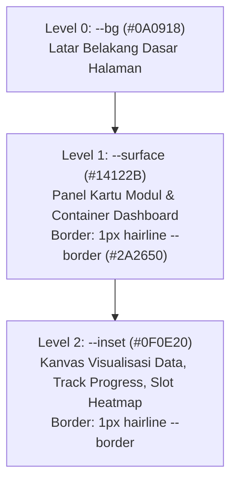

# 02-DESIGN-SYSTEM.MD — Token Desain, Tipografi, & Estetika Visual

> Sumber kebenaran visual (*Single Source of Truth*) untuk **Website 08: OmniHR Pulse**. Mengatur token warna, tipografi, hierarki permukaan, batas garis (*hairlines*), dan pemetaan ke Tailwind CSS.

---

## 1. Filosofi Desain: Data & Analytics Centric
Desain OmniHR Pulse dibangun di atas konsep **ruang kerja analitik gelap yang tenang (*calm dark-mode analytics workspace*)**.
- Bukan tampilan aplikasi kasual atau landing page SaaS generik bertabur gradien hiasan.
- Warna tidak digunakan sebagai dekorasi acak, melainkan **hadir sebagai pendar sinyal data (*data as illumination*)**: garis tren, isian di bawah kurva, gradasi sel heatmap, dan indikator jarum gauge.
- Komposisi bertumpuk tiga tingkat permukaan secara disiplin tanpa bayangan mengambang berlebihan (*no heavy drop shadows*).
- Setiap metrik didampingi konteks manusia melalui foto editorial berbingkai data.

---

## 2. Palet Warna & Token (OKLCH + Hex)

| Token CSS | Representasi OKLCH | Nilai Hex | Peran dalam Antarmuka |
|---|---|---|---|
| `--bg` | `oklch(0.151 0.032 285)` | `#0A0918` | Latar belakang dasar seluruh halaman |
| `--surface` | `oklch(0.200 0.049 284.7)` | `#14122B` | Permukaan kartu modul, kontainer live dashboard |
| `--inset` | `oklch(0.175 0.040 285)` | `#0F0E20` | Bidang dalam kartu, kanvas grafik SVG, track bar |
| `--fg` | `oklch(0.958 0.015 298.6)` | `#F2EFFA` | Teks utama, angka sorotan, judul |
| `--muted` | `oklch(0.694 0.055 290.9)` | `#9C97BD` | Teks pendukung, label sumbu, sub-judul |
| `--border` | `oklch(0.296 0.074 285.3)` | `#2A2650` | Garis hairline 1px pemisah kartu dan section |
| `--accent` | `oklch(0.606 0.219 292.7)` | `#8B5CF6` | **Electric Purple:** Garis seri data utama, active dot |
| `--accent-strong` | `oklch(0.541 0.246 293)` | `#7C3AED` | Latar tombol CTA utama (rasio kontras 5.7:1 terhadap putih) |
| `--indigo` | `oklch(0.457 0.215 277)` | `#4338CA` | **Deep Indigo:** Garis sekunder, isian area data, brand mark |
| `--il-3` | `oklch(0.833 0.091 292.1)` | `#C4B5FD` | Garis target/ambang batas, highlight hover |
| `--ok` | `oklch(0.76 0.15 162)` | `#22C55E` | Status sinkronisasi aktif (*live dot*), kenaikan positif |
| `--warn` | `oklch(0.83 0.14 82)` | `#F59E0B` | Status peringatan risiko, potensi kekurangan staf |

### Kontras Aksesibilitas Terukur
- `fg` / `bg`: **17.4:1** (Jauh melampaui standar WCAG AAA 7:1)
- `muted` / `surface`: **6.6:1** (Memenuhi standar WCAG AA 4.5:1)
- `putih` / `accent-strong`: **5.7:1** (Memenuhi standar tombol WCAG AA)

---

## 3. Sistem Tipografi (Google Fonts via Next.js)

Pengaturan tipografi menggunakan tiga keluarga font spesifik yang diunduh otomatis via `next/font/google`:

```tsx
// src/app/layout.tsx
import { Plus_Jakarta_Sans, Inter, JetBrains_Mono } from 'next/font/google';

const displayFont = Plus_Jakarta_Sans({
  subsets: ['latin'],
  weight: ['500', '600', '700'],
  variable: '--font-display',
  display: 'swap',
});

const bodyFont = Inter({
  subsets: ['latin'],
  weight: ['400', '500'],
  variable: '--font-body',
  display: 'swap',
});

const monoFont = JetBrains_Mono({
  subsets: ['latin'],
  weight: ['400', '500', '600'],
  variable: '--font-mono',
  display: 'swap',
});
```

### Panduan Penggunaan Huruf:
1. **Display Font (`Plus Jakarta Sans`):**
   - Digunakan untuk: H1, H2, H3, dan judul utama section.
   - Sifat: Geometris modern, sedikit rapat (`letter-spacing: -0.02em`), bobot *semi-bold* (600).
2. **Body Font (`Inter`):**
   - Digunakan untuk: Paragraf lead, deskripsi modul, teks pengantar, poin benefit.
   - Sifat: Sangat mudah dibaca pada layar gelap resolusi tinggi, line-height 1.6.
3. **Mono Font (`JetBrains Mono`):**
   - Digunakan untuk: Semua angka statistik, persentase, label kicker, tag kategori, sumbu koordinat grafik (X & Y axis), indeks modul (`01`, `02`), dan kode waktu.
   - Karakteristik wajib: `font-variant-numeric: tabular-nums` (angka monospaced sejajar sempurna).

---

## 4. Hierarki Permukaan (The 3-Tier Surface System)
Untuk menghindari bayangan mengambang tebal yang sering menjadi ciri khas template AI generik, OmniHR Pulse menggunakan model 3 lapis kedalaman arsitektural:



- **Radius Sudut:**
  - Standard buttons, tags, & small inputs: `10px` (`--radius`)
  - Kartu foto & panel visual modul: `18px` (`--radius-lg`)
  - Kontainer Hero Live Dashboard: `22px`
- **Pemisah Antar-Bagian:** `border-top: 1px solid var(--border)` tanpa garis tebal atau bayangan kasar.

---

## 5. Standar Foto & Visual Editorial
Foto diambil dari direktori referensi lokal `OmniHR-reference-assets`:
1. `hero.jpg`: Tim berdiskusi dengan laptop, tablet, dan lembar analitik.
2. `absensi.jpg`: Karyawan membuka pintu kaca kantor pada check-in pagi hari.
3. `gaji.jpg`: Staf finance memeriksa slip gaji digital dan dokumen anggaran.
4. `exam.jpg`: Sesi pelatihan dan ujian kompetensi di ruang kantor.
5. `perizinan.jpg`: Karyawan duduk santai di rumah dengan cangkir kopi.
6. `library.jpg`: Tim meninjau map SOP operasional bersama.

### Aturan Perlakuan Foto:
- Foto ditempatkan di dalam bingkai `.illu-card` dengan border `1px solid var(--border)`.
- Menggunakan CSS filter lembut: `filter: saturate(0.9) contrast(1.04)` agar menyatu sempurna dengan atmosfer gelap workspace.
- Dilengkapi caption monospaced di bagian bawah foto (misal: `Check-in lapangan · shift pagi | 08.57`).

---

## 6. Pemetaan Konfigurasi Tailwind CSS (`tailwind.config.ts`)

```typescript
import type { Config } from "tailwindcss";

const config: Config = {
  content: [
    "./src/pages/**/*.{js,ts,jsx,tsx,mdx}",
    "./src/components/**/*.{js,ts,jsx,tsx,mdx}",
    "./src/app/**/*.{js,ts,jsx,tsx,mdx}",
  ],
  theme: {
    extend: {
      colors: {
        bg: "var(--bg)",
        surface: "var(--surface)",
        inset: "var(--inset)",
        fg: "var(--fg)",
        muted: "var(--muted)",
        border: "var(--border)",
        accent: {
          DEFAULT: "var(--accent)",
          strong: "var(--accent-strong)",
          soft: "var(--accent-soft)",
          line: "var(--accent-line)",
        },
        indigo: {
          DEFAULT: "var(--indigo)",
        },
        ok: "var(--ok)",
        warn: "var(--warn)",
      },
      fontFamily: {
        display: ["var(--font-display)", "sans-serif"],
        body: ["var(--font-body)", "sans-serif"],
        mono: ["var(--font-mono)", "monospace"],
      },
      borderRadius: {
        card: "18px",
        dash: "22px",
      },
    },
  },
  plugins: [],
};

export default config;
```

---

## 7. Responsivitas & Mode Motion
- **Breakpoint Utama:**
  - Mobile: `< 920px` (layout bertransformasi ke satu kolom penuh, padding container berkurang ke 20px, navigasi menjadi mobile-friendly).
  - Tablet/Laptop: `920px – 1180px`.
  - Desktop: `1180px` (lebar kontainer maksimal dengan gutter 32px).
- **Reduced Motion Support:**
  Jika sistem mendeteksi `@media (prefers-reduced-motion: reduce)`, seluruh animasi berulang (floaty chips, pulse live dot, needle rotation) disederhanakan ke posisi statis final seketika.
