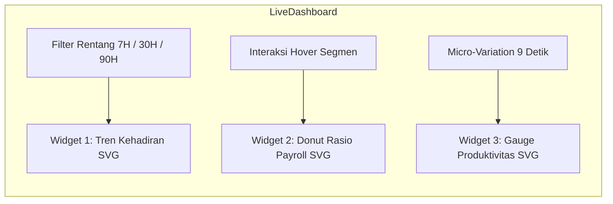

# 04-ANALYTICS-MODULES.MD — Spesifikasi Teknis Interaktivitas & Kalkulasi Data

> Dokumen spesifikasi teknis matematika visualisasi data SVG, model dataset demo, logika kalkulasi, dan interaksi pengguna untuk Hero Live Dashboard dan 5 Modul HRIS pada **Website 08: OmniHR Pulse**.

---

## 1. Hero Live Dashboard (`#demo`)
Live Dashboard merupakan atraksi utama pada halaman depan yang mensimulasikan ruang kendali metrik SDM real-time. Komponen dibangun dengan SVG murni dan React State tanpa dependensi grafik eksternal yang berat.

### 1.1 Widget 1: Attendance Trend Line Chart
Menampilkan grafik garis tren ketepatan waktu dengan kurva Bezier halus (*smooth cubic spline*), grid horizontal, dan crosshair interaktif.

- **Dataset per Rentang Waktu:**
  - `7H`: Nilai `[92.6, 93.4, 91.9, 94.8, 93.1, 95.2, 94.2]`, Sumbu X: `['15/10', '17/10', '19/10', '21/10']`, Rata-rata: `93.6%`
  - `30H` (Default): 30 titik data harian (kisaran 90.4% hingga 95.0%), Sumbu X: `['22/09', '02/10', '11/10', '21/10']`, Rata-rata: `94.2%`
  - `90H`: 12 titik mingguan `[89.8, 90.6, 91.4, 90.9, 92.0, 92.8, 92.1, 93.0, 93.6, 93.2, 93.9, 94.2]`, Sumbu X: `['Agu', 'Sep', 'Okt', '21/10']`, Rata-rata: `92.4%`
- **Dimensi & Koordinat SVG:**
  - ViewBox: `0 0 420 148`
  - Batas Margin: Kiri (`AL = 4`), Kanan (`AR = 4`), Atas (`AT = 12`), Bawah (`AB = 14`).
  - Skala Sumbu Y: Rentang nilai `88%` sampai `98%`.
    $$\text{pos } Y = (148 - AB) - \frac{v - 88}{10} \times (148 - AT - AB)$$
- **Garis Target Ambang Batas:**
  - Garis putus-putus pada $Y = 92\%$ (`stroke: var(--il-3)`, `stroke-dasharray: 3 4`, `opacity: 0.4`).
- **Formula Kurva Bezier Halus:**
  Menggunakan Catmull-Rom to Cubic Bezier translation:
  $$C_{1x} = P_{1x} + \frac{P_{2x} - P_{0x}}{6}, \quad C_{1y} = P_{1y} + \frac{P_{2y} - P_{0y}}{6}$$
  $$C_{2x} = P_{2x} - \frac{P_{3x} - P_{1x}}{6}, \quad C_{2y} = P_{2y} - \frac{P_{3y} - P_{1y}}{6}$$
- **Interaksi Kursor:**
  - Saat kursor bergerak di atas SVG, cari indeks titik $i$ terdekat:
    $$i = \text{clamp}\left(0, n-1, \text{round}\left(\frac{v_x - AL}{\text{jarak per titik}}\right)\right)$$
  - Tampilkan garis crosshair vertikal di $X = P_{ix}$ dan munculkan Tooltip:
    `<b>${fmt(nilai)}%</b> tepat waktu`

---

### 1.2 Widget 2: Payroll Budget Ratio Donut Chart
Menampilkan proporsi alokasi pengeluaran gaji berjalan terhadap pagu anggaran Rp 10 Miliar.

- **Data Segmen:**
  - Gaji Pokok: `62%` (`--accent` `#8B5CF6`)
  - Lembur: `14%` (`--indigo` `#4338CA`)
  - Tunjangan: `24%` (`--il-3` `#C4B5FD`)
  - Total Terpakai: `84%` (`Rp 8,4 M` dari pagu `Rp 10 M`)
- **Kalkulasi SVG Lingkaran:**
  - Radius: $R = 46$, Pusat: $(60, 60)$, Tebal Stroke: $13\text{px}$.
  - Keliling Lingkaran: $C = 2 \times \pi \times 46 \approx 289.026$.
  - Setiap segmen memiliki panjang $\text{len} = \frac{v}{100} \times C$.
  - Format SVG: `stroke-dasharray: ${len} ${C - len}`, rotasi dasar `-90deg`, dengan `stroke-dashoffset: -offset`.
- **Interaksi Hover Segmen:**
  - Saat segmen disentuh, tebal lingkaran membesar menjadi $15\text{px}$.
  - Teks tengah dinamis berganti dari `Rp 8,4 M / dari 10 M` menjadi persentase dan nama segmen (`62% / Gaji pokok`).
  - Tooltip muncul menunjukkan rincian nilai.

---

### 1.3 Widget 3: Productivity Gauge Meter
Menampilkan skor indeks efisiensi kerja tim dalam bentuk busur setengah lingkaran.

- **Spesifikasi SVG:**
  - ViewBox: `0 0 180 104`, Radius busur: $68\text{px}$.
  - Path Busur: `M 22 88 a 68 68 0 0 1 136 0` (Panjang busur $\approx 214\text{px}$).
  - Jalur Dasar: `stroke-width: 11`, abu-abu gelap transparan.
  - Jalur Isian: `stroke-dasharray: 214`, `stroke-dashoffset: 214 * (1 - nilai / 100)`.
- **Rotasi Jarum Indikator:**
  - Sudut Jarum: $\text{deg} = \left(\frac{\text{nilai}}{100} \times 180\right) - 90$.
  - Titik tumpu rotasi (*transform-origin*): `90px 88px`.
- **Status & Detak Mikro (Heartbeat):**
  - Nilai dasar: `78 / 100` (Status: *Produktif*). Target kuartal: `82`.
  - Simulasi Real-Time: Tiap 9 detik, nilai berfluktuasi tipis antara `76 – 81` dengan transisi halus `cubic-bezier(0.2, 0.8, 0.2, 1)` (non-aktif jika *reduced motion* aktif).

---

## 2. Rincian Teknis 5 Modul HRIS

### 2.1 Modul 01: Absensi & Heatmap Kehadiran Mingguan
- **Grafik Garis Mini (Tren 30 Hari):**
  - ViewBox: `0 0 480 120`.
  - Garis solid ungu + gradien linier transparan di bawah kurva + garis putus-putus target 92%.
  - Titik dot menyala di ujung data terakhir (hari ke-30).
- **Heatmap 7×12 Jam Kehadiran:**
  - Matriks: 7 hari baris (`Sen`, `Sel`, `Rab`, `Kam`, `Jum`, `Sab`, `Min`) × 12 kolom jam kerja (`08.00` hingga `19.00`).
  - Total 84 sel interaktif.
  - Formula Kepadatan Sel ($v$):
    - Hari kerja (Sen–Jum): nilai dasar $0.5$, puncak tinggi ($+0.28$) di jam masuk (08.00–09.00), siang (12.00–14.00), dan jam pulang (17.00–19.00).
    - Akhir pekan (Sab–Min): nilai dasar $0.12$.
  - Pewarnaan OKLCH Berdasarkan Nilai $v$:
    $$\text{background} = \text{oklch}((0.245 + v \times 0.55) \quad (0.03 + v \times 0.12) \quad 290)$$
  - Hover Effect: Sel membesar `transform: scale(1.18)`, border outline putih, dan tooltip informatif:
    `Sen 09.00 · <b>42</b> check-in`

---

### 2.2 Modul 02: Gaji / Payroll & Proyeksi Biaya
- **Grafik Proyeksi Pengeluaran 8 Bulan:**
  - ViewBox: `0 0 480 130`.
  - Data Realisasi (Solid, Garis Ungu): Jun (`7.2 M`), Jul (`7.4 M`), Agu (`7.1 M`), Sep (`7.8 M`), Okt (`8.4 M`).
  - Data Proyeksi (Putus-putus, Garis Lavender): Nov (`8.7 M`), Des (`8.9 M`), Jan (`9.2 M`).
  - Batas Pagu Anggaran: Garis abu-abu putus-putus pada $Y = 10\text{ M}$.
- **Distribusi Beban Lembur Per Divisi:**
  - Sales: `1.284 jam` (Warna aksen ungu menyala, bar terpanjang)
  - Operasional: `962 jam`
  - Customer Care: `740 jam`
  - Finance: `418 jam`
  - Tech: `356 jam`
  - Persentase bar dihitung terhadap nilai maksimum (1.284 jam).

---

### 2.3 Modul 03: Exam & Kurva Normal Kinerja
- **Kurva Normal Gaussian ($40 \le s \le 100$):**
  - Rata-rata ($\mu$): $74$
  - Standar Deviasi ($\sigma$): $9$
  - Formula Tinggi Kurva:
    $$f(s) = \exp\left(-\frac{(s - 74)^2}{2 \times 9^2}\right)$$
  - Garis tegak di $\mu = 74$ dengan label teks monospaced `μ 74`.
  - Shaded Pass Band: Bidang ungu muda transparan pada rentang nilai kelulusan $60$ sampai $85$.
- **Skill-Gap Analysis Bar:**
  - Sales: `22%` (Hot accent)
  - Customer Care: `18%`
  - Operasional: `11%`
  - Finance: `7%`

---

### 2.4 Modul 04: Perizinan & Musim Cuti Tahunan
- **Grafik Kolom 12 Bulan (% Karyawan Cuti):**
  - Data: Jan (`8%`), Feb (`7%`), Mar (`9%`), Apr (`11%`), Mei (`6%`), Jun (`14%`), Jul (`10%`), Agu (`7%`), Sep (`9%`), Okt (`11%`), Nov (`13%`), Des (`18%`).
  - Kolom bulan Desember (18%) dan Juni (14%) diberi status `hot` dengan latar ungu terang.
  - Hover tooltip memperlihatkan: `<b>18%</b> karyawan cuti`.
- **Kotak Peringatan Operasional (Risk Callout):**
  - Border kuning peringatan (`--warn`) dengan dot kuning berkedip.
  - Salinan: *"Desember: 18% tim operasional cuti bersamaan dengan puncak pesanan. Proyeksi kekurangan 9 staf per pekan."*
- **Ringkasan Indikator Cuti:**
  - `31`: Pengajuan menunggu persetujuan
  - `4,2`: Rata-rata durasi cuti (hari)
  - `12`: Hari saldo cuti tahunan terpakai

---

### 2.5 Modul 05: Library & Pelacakan Kepatuhan SOP
- **Daftar Kepatuhan Dokumen (Progress Rows):**
  1. *SOP Keamanan Data v4.2:* `96%` (230 / 240 staf telah membaca dan mengonfirmasi).
  2. *Prosedur Refund & Retur:* `88%` (211 / 240 staf).
  3. *Panduan Layanan Pelanggan:* `82%` (197 / 240 staf) (Status low, bar ungu aksen).
- **Animasi Bar:** Menggunakan lebar `width: X%` dengan transisi halus saat halaman dimuat.
- **Statistik Pelengkap:**
  - `89%`: Rata-rata tingkat baca seluruh perusahaan
  - `26`: Karyawan belum memberikan konfirmasi
  - `2,1 hari`: Rata-rata waktu penyelesaian sejak dokumen dirilis
